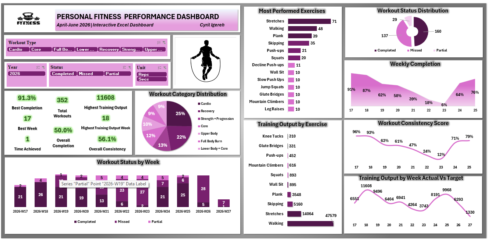

# 🏋️ Fitness Performance & Body Metrics Tracker

## Overview

The **Fitness Performance & Body Metrics Tracker** is an interactive, data-driven Excel solution designed to monitor, analyze, and visualize personal fitness progress and physiological changes over time. Spanning data collections primarily from April to June 2026 (with extended tracking entries), this project bridges health tracking with advanced dashboard design to deliver clear, actionable insights into training habits, consistency, and body composition.

---

## Objectives

* **Monitor Workout Consistency:** Track weekly and overall completion rates to evaluate adherence to planned fitness routines.

* **Analyze Training Output:** Measure physical output volumes across various exercise categories (such as Cardio, Core, Strength, and Recovery).

* **Track Body Composition:** Log and evaluate physical changes across key metrics including weight, waist, tummy, chest, arm, and thigh dimensions.

* **Provide Interactive Visualizations:** Build dynamic Excel dashboards equipped with slicers and pivot tables for seamless data filtering and exploration.

---

## Tools Used

* **Microsoft Excel:** Utilized for data modeling, pivot tables, slicers, conditional formatting, and dynamic dashboard creation.
* **Excel Formulas & Pivot Structures:** Used for calculating performance scores, actual vs. target training outputs, and measurement shifts.

---

## Exercise Performance Dashboard

The **Personal Fitness Performance Dashboard** provides a macro and micro view of training routines between April and June 2026:

* **High-Level KPIs:** Features metrics such as an overall workout completion rate of **50.0%**, a best completion rate of **91.3%** (achieved in Week 17), **352 total workouts**, and an overall training consistency of **56.1%**.

* **Workout Category Distribution:** Breaks down training focus into categories like Cardio (25%), Recovery (22%), Strength + Progression (13%), Core (12%), Upper Body (10%), Full Body Burn (9%), and Lower Body + Core (9%).

* **Consistency & Weekly Tracking:** Includes visual line charts tracking weekly completion percentages, workout status distributions (Completed, Missed, Partial), and actual versus target training output volumes across weeks W17 to W27.

* **Interactive Slicers:** Allows filtering by Workout Type, Year (2026), Status, and Unit (Reps vs. Secs).

---

## Body Metrics Dashboard

The **Personal Body Metrics Dashboard** monitors physiological changes and body composition trends:

* **Current Measurements:** Highlights latest metrics including a current weight of **93.5 kg**, waist of **95.8 cm**, tummy of **107.1 cm**, chest of **106.8 cm**, arm of **37.0 cm**, and thigh of **57.5 cm**.

* **Trend Analysis Charts:** Visualizes longitudinal shifts in tummy, waist, weight, chest, thigh, and arm dimensions from April through October 2026.

* **Measurement Change Tracking:** Highlights net variances across body parts, showing gains and reductions such as a **+2.5 cm** change in thighs, **+2.8 cm** in chest and waist, and **-1.0 cm** in arms.

(body-metrics-dashboard.png)

---

## Analysis

* **Adherence & Fatigue Cycles:** The weekly completion trend indicates high initial engagement in Week 17 (91%) followed by a gradual tapering mid-program down to 6% in Week 23, before rebounding strongly to 76% by Week 25.

* **Volume vs. Variety:** Stretches, walking, planks, and skipping dominated the most performed exercise lists, while high-output metrics clustered heavily around bodyweight movements like squats, wall sits, and mountain climbers.

* **Body Metric Fluctuations:** Weight fluctuated between a low of 92.4 kg (late April) and 93.5 kg, while waist and tummy measurements showed localized adaptive responses alongside chest and thigh muscle modifications.

---

## Key Insights

* **Consistency Drives Performance:** Weeks with higher workout consistency scores directly mirrored higher training output totals, proving that routine adherence is the primary driver of physical workload capacity.

* **Cardio & Recovery Dominance:** The user dedicated nearly half of their training focus to Cardio (25%) and Recovery (22%), reflecting a balanced approach to endurance and physical restoration.

* **Stable Composition with Targeted Shifts:** Despite active tracking over multiple months, overall body weight remained remarkably stable around the mid-90 kg range, while localized muscle and girth metrics experienced targeted volumetric shifts.

---

## Project Outcome

Successfully transformed raw fitness and body measurement logs into professional, fully interactive Excel dashboards. This project demonstrates advanced data organization, KPI tracking, and visual storytelling capabilities tailored to health and fitness analytics.
