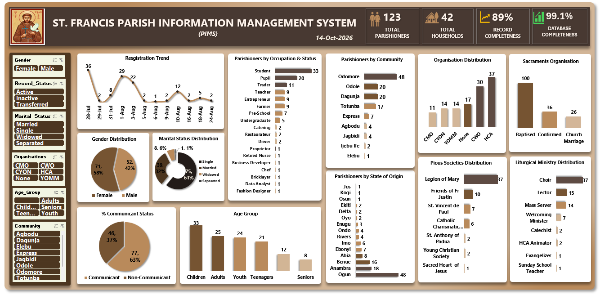

# ⛪ Parish Information Management System (PIMS)

## 📌 Overview

An Excel-based Parish Information Management System designed to organize, manage, and analyze parish records in a structured and efficient way.

The project was developed to demonstrate how Excel can be used beyond basic spreadsheets to create a structured information management and reporting system.

## 🎯 Objectives

- Organize parish information in a structured database
- Improve accessibility and consistency of parish records
- Reduce manual data handling and duplication
- Enable efficient reporting and analysis
- Provide a centralized system for managing parish information

## 🛠 Tools & Technologies

- Microsoft Excel
- Power Query
- Power Pivot
- PivotTables
- Data Validation
- Excel Charts
- Slicers
- Data Modeling

## 🗂️ System Structure

The system organizes parish information across related data tables, allowing records to be maintained and analyzed systematically.

Key information areas include:

- Parishioners
- Societies
- Ministries
- Sacraments
- Other parish-related records

## 🧹 Data Management

The system incorporates structured data-entry and validation techniques to improve data quality and consistency.

Power Query was used for data preparation and transformation, while Power Pivot was used to support relationships and analysis across the data model.

## 📊 Reporting & Dashboard

The system includes interactive reporting features that allow parish information to be explored through:

- PivotTables
- Charts
- Slicers
- Summary reports
- Interactive filtering

## 💡 Key Capabilities

- Centralized parish record management
- Structured and relational data organization
- Data validation for improved accuracy
- Automated data transformation
- Interactive reporting and filtering
- Analytical summaries for decision-making

## 🎯 Project Outcome

The project demonstrates how Microsoft Excel can be used to develop a practical information management solution that combines data organization, transformation, modeling, analysis, and visualization in one system.
